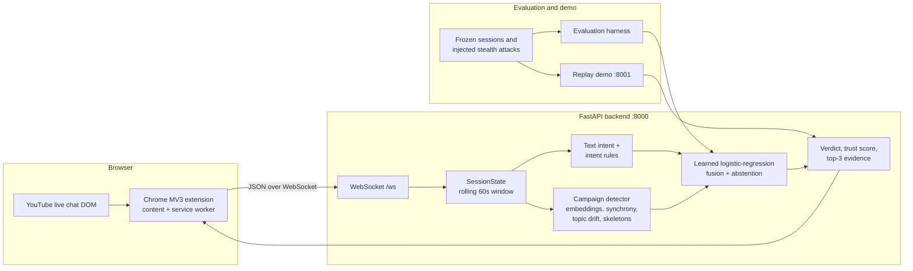

<div align="center">

# Scam Shield

**Estimating coordinated scam-campaign membership in YouTube live chat from structural signals — not from a single sentence.**

[](LICENSE)
[](https://www.python.org/)
[](https://fastapi.tiangolo.com/)
[](https://scikit-learn.org/)
[](extension/manifest.json)
[](#project-status-and-limitations)

</div>

---

## Overview

Scam Shield is a research prototype for detecting **coordinated scam campaigns** in YouTube live chat. It does not claim to detect AI-written text. A single fluent sentence is not reliable evidence of automation, and a text-only detector can be evaded by paraphrasing while generating false positives on ordinary viewers.

Instead, the system estimates whether a message or account belongs to a coordinated campaign using signals that are harder to fake in isolation:

- multiple accounts converging on the same semantic content within a rolling time window;
- synchronized arrival rates relative to the background chat;
- divergence from the stream's recent topic centroid;
- in-session account history and first-seen timing;
- repeated lexical templates;
- platform role badges as protective signals;
- explicit solicitation patterns such as short links, handles, and crypto wallets.

The output is a trust score, a verdict (`clear`, `suspicious`, `likely_campaign`, or `unverifiable`), and up to three concrete evidence items. When the structural evidence is insufficient, the system deliberately abstains instead of guessing.

The recorded evaluation shows the prototype is **not yet reliable enough for moderation use**: held-out precision was 7.89%, and recall degraded sharply at higher stealth levels. Those results are reported in [Evaluation](#evaluation) rather than hidden.

## Research questions

**RQ1 — Robustness across the stealth ladder.** How does detection degrade as attackers move from copy-paste bursts (L0) to template substitution (L1), LLM paraphrases (L2), contextual chameleons (L3), and low-and-slow swarms (L4)?

**RQ2 — Organic versus malicious synchrony.** Live audiences legitimately synchronize during hype spikes, raids, copypastas, and emote trains. Can the detector preserve recall on campaigns without flagging genuine collective behavior?

**Deliberate abstention.** When textual and structural evidence are both insufficient — for example, one isolated account posting one natural message with no links — the system returns `unverifiable` rather than forcing a binary decision.

## Detection signals

The learned fusion model consumes the 11 features defined in `ml/learned_fusion.py`.

| Signal | What it measures | Source |
| :--- | :--- | :--- |
| `text_scam_prob` | Char n-gram TF-IDF + logistic-regression solicitation probability | `ml/text_intent.py`, `ml/text_scorer.py` |
| `cluster_account_count` | Distinct accounts in the semantic neighborhood | `ml/campaign_detector.py` |
| `cluster_cohesion` | Mean cosine similarity of recent semantically related messages | `ml/campaign_detector.py` |
| `rate_normalized_synchrony` | Cluster message rate normalized by background chat velocity | `ml/campaign_detector.py` |
| `off_topic_distance` | Cosine distance from the running stream topic centroid | `ml/campaign_detector.py` |
| `skeleton_reuse_ratio` | Token-level Jaccard overlap after replacing links, handles, wallets, and numbers | `ml/campaign_detector.py` |
| `account_first_seen_delta` | Time between first appearance and current activity | `ml/behavioral_profiler.py` |
| `account_msg_count` | Messages from the same account in the active session | `ml/session_state.py` |
| `is_trusted_badge` | Member, moderator, or verified platform badge | `ml/campaign_detector.py` |
| `intent_rules_hit` | External link, shortener, Telegram/WhatsApp handle, or wallet address | `ml/intent_rules.py` |
| `is_organic_hype_pattern` | Short-text community hype / emote-train discriminator | `ml/campaign_detector.py` |

Embeddings come from `sentence-transformers/all-MiniLM-L6-v2` (384 dimensions). If the model cannot load, the detector falls back to deterministic pseudo-embeddings; that fallback preserves execution but is **not** semantically meaningful, so results from that mode should not be interpreted as model performance.

## Architecture



### Runtime flow

1. The content script observes new live-chat messages and forwards normalized comments to the service worker.
2. The service worker maintains the WebSocket connection to `ws://127.0.0.1:8000/ws`.
3. The backend keeps a per-connection `SessionState` with a 60-second, size-bounded rolling window and per-account profiles.
4. Text intent, intent rules, and campaign features are computed; the fusion model produces a probability and verdict.
5. The extension renders a badge on the message and a popover with the top three evidence items.

## Tech stack

| Layer | Technology | Role |
| :--- | :--- | :--- |
| Extension | Chrome Manifest V3, vanilla JavaScript | Live-chat observer, WebSocket bridge, badge/popover UI |
| Backend | Python 3.10+, FastAPI 0.104.1, Uvicorn | Scoring API and WebSocket server |
| ML | scikit-learn, NumPy, pandas, SciPy | TF-IDF text classifier and logistic-regression fusion |
| Semantics | sentence-transformers (`all-MiniLM-L6-v2`) | Dense message embeddings and topic centroid |
| Demo | FastAPI, vanilla HTML/CSS/JS, WebSocket | Replay dashboard with adjustable speed and stealth level |
| Evaluation | scikit-learn metrics, matplotlib, bootstrap CI | Baselines, stealth ladder, ablations, latency |
| Data | JSONL sessions, UCI YouTube Spam Collection | Public data, salted-hashed authors, injected attacks |

## Project structure

```text
IDP/
├── backend/main.py              # FastAPI app, WebSocket scoring, replay endpoint
├── extension/                   # Chrome MV3 content script, service worker, popup
├── ml/
│   ├── fusion.py                # End-to-end scoring entry point
│   ├── campaign_detector.py     # Semantic clustering, synchrony, topic drift
│   ├── text_intent.py           # Char n-gram TF-IDF + logistic regression
│   ├── text_scorer.py           # Text scoring facade with LRU cache
│   ├── intent_rules.py          # Link, handle, wallet, solicitation patterns
│   ├── behavioral_profiler.py   # In-session account behavior
│   ├── session_state.py         # Rolling window and user profiles
│   ├── learned_fusion.py        # 11-feature fusion and abstention logic
│   └── eval_results.md          # Recorded held-out evaluation output
├── attacks/                     # Stealth-ladder generation and injection
├── data/
│   ├── sessions/                # Anonymized session JSONL
│   ├── injected/                # Frozen attack-injected sessions
│   └── labeled/                 # Annotated comments
├── eval/                        # Harness, frozen hashes, failure analysis, plots
├── demo/                        # Replay server and inspector dashboard
├── scripts/                     # Collection, labeling, training, simulation
└── tests/                       # Feature, pipeline, and WebSocket smoke tests
```

Trained model files (`ml/_text_intent_model.pkl`, `ml/_fusion_model.pkl`) are git-ignored. Train them locally before reproducing the recorded numbers.

## Prerequisites

- Python 3.10 or newer.
- Chrome or another Chromium-based browser for the extension.
- A CPU is sufficient for scoring and evaluation; no API keys are required.
- The first embedding-model load downloads `all-MiniLM-L6-v2`, so an internet connection or a populated Hugging Face cache is required once.
- Training and evaluation use the committed UCI-derived sessions; no live YouTube access is needed.

## Setup

```bash
git clone https://github.com/ishanvaidya01/Scam-Sheild.git
cd Scam-Sheild
python -m venv .venv
# Windows PowerShell:
.\.venv\Scripts\Activate.ps1
# macOS / Linux:
# source .venv/bin/activate
python -m pip install --upgrade pip
python -m pip install -r backend/requirements.txt
python -m pip install pytest
```

`install.py` is an optional convenience script that installs requirements, downloads the spaCy English model, and fetches the public UCI dataset. It is not required for the committed sessions.

### Train the models

Run these from the repository root, in order:

```bash
python scripts/train_text_model.py
python scripts/train_fusion_model.py
```

The first command trains the char n-gram text classifier on dev videos and writes `ml/_text_intent_model.pkl`. The second builds the 11-feature fusion model on dev sessions, selects the operating threshold on dev, and writes `ml/_fusion_model.pkl`.

If the model files are absent, the code still runs with fallback/default scoring, but the recorded evaluation is not reproducible.

### Run the backend

```bash
cd backend
uvicorn main:app --reload --port 8000
```

The extension expects `127.0.0.1:8000`. To allow cross-origin clients, set `ALLOWED_ORIGINS` (comma-separated) before starting; the default is `*`.

### Load the extension

1. Open `chrome://extensions`.
2. Enable **Developer mode**.
3. Choose **Load unpacked** and select the `extension/` directory.
4. Open a YouTube live stream with chat.
5. Use the toolbar popup to pause or resume the shield and to view scanned/flagged/scam counters.

The extension connects to `ws://127.0.0.1:8000/ws` by default. The optional `backendHost` key in `chrome.storage.local` overrides the host; there is currently no settings UI for it.

### Run the replay demo

```bash
python demo/replay_server.py
```

Open http://localhost:8001. The dashboard replays a frozen injected session with adjustable speed and stealth level, and compares the text-only baseline (B2) with the full system (B4).

The **Training Studio** panel in the demo is an illustrative animation, not a live training run. Its displayed metrics are hard-coded and should not be cited as results. Use `eval/run_eval.py` for measurements.

## Environment variables

| Variable | Default | Used by | Description |
| :--- | :--- | :--- | :--- |
| `ALLOWED_ORIGINS` | `*` | `backend/main.py` | Comma-separated CORS origins. |
| `backendHost` (chrome.storage) | `127.0.0.1:8000` | Extension service worker | WebSocket host override; not an OS environment variable. |

The backend does not load a `.env` file automatically. If you use one, start Uvicorn with `--env-file .env`. A template is provided in [.env.example](.env.example).

## Usage

### WebSocket scoring contract

Connect to `ws://127.0.0.1:8000/ws` and send one JSON object per comment:

```json
{
  "comment_id": "msg_001",
  "text": "Claim the bonus at t.me/example",
  "username": "viewer_42",
  "timestamp": 1712000000000,
  "badges": []
}
```

The response includes `comment_id`, `trust_score`, `campaign_prob`, `verdict`, `verdict_label`, `unverifiable`, `reasons` (maximum three), `signal_breakdown`, and `session_stats`.

Send `{"type": "GET_STATS"}` for the current session counters. A malformed JSON payload closes the connection; there is no retry protocol beyond the extension's reconnect logic.

### Replay from a file

The backend exposes `POST /replay` with `file_path` and `speed` query parameters. It accepts a CSV or JSONL file and streams scored results to connected WebSocket clients. Example:

```bash
curl -X POST "http://localhost:8000/replay?file_path=data/injected/session_eminem_test_L2.jsonl&speed=5"
```

The path is resolved relative to the backend process working directory, and the endpoint starts a background task rather than returning results inline.

### Interpreting verdicts

- **Clear** — low campaign probability.
- **Suspicious** — moderate probability; review recommended.
- **Likely Campaign** — probability at or above the learned campaign threshold.
- **Unverifiable** — insufficient structural evidence; the system deliberately abstains.

## API reference

Backend (`backend/main.py`, port 8000):

| Method | Endpoint | Purpose |
| :--- | :--- | :--- |
| `GET` | `/` | Health check with version and active connection count |
| `GET` | `/stats` | Aggregate and per-session counters |
| `POST` | `/replay?file_path=&speed=` | Stream a CSV/JSONL replay to connected clients |
| `WS` | `/ws` | Comment scoring and `GET_STATS` control messages |

Demo server (`demo/replay_server.py`, port 8001):

| Method | Endpoint | Purpose |
| :--- | :--- | :--- |
| `GET` | `/` | Inspector dashboard |
| `GET` | `/style.css`, `/app.js` | Static demo assets |
| `WS` | `/ws/demo` | Start/pause/configure a replay and receive scored messages |
| `WS` | `/ws/train` | Training-studio animation stream (illustrative only) |

There is no authentication layer and no persistence API. The backend stores session state in process memory.

## Evaluation

### Protocol

- **Session-level splits, never random rows.** Dev videos: UCI Psy, Katy Perry, LMFAO. Test videos: Eminem, Shakira, plus held-out organic-hype sessions.
- **Frozen test set.** SHA-256 hashes for sessions and injected attack files are recorded in `eval/FROZEN.md`.
- **Injected stealth ladder.** L0 copy-paste, L1 template substitution, L2 LLM paraphrase, L3 contextual infiltration, L4 low-and-slow, and L3-single (one isolated message).
- **Operating point selected on dev**, targeting a false-positive rate of at most 1% on genuine messages, then applied unchanged to test.
- **Baselines.** B1 near-duplicate matching, B2 text-only intent, B3 legacy heuristics, B4 full system.
- **Recorded run.** `ml/eval_results.md`, generated 2026-10-13 on Windows 11. Numbers are reported as recorded; they were not independently re-verified for this README.

### Recorded held-out test results

| Model | Precision | Recall | F1 | PR-AUC | ROC-AUC | FPR (genuine) | FPR (organic hype) |
| :--- | ---: | ---: | ---: | ---: | ---: | ---: | ---: |
| B1 near-duplicate | 0.3462 | 0.7200 | 0.4675 | 0.5349 | 0.8509 | 0.00% | 0.00% |
| B2 text-only | 0.0222 | 0.8200 | 0.0432 | 0.0184 | 0.6655 | 48.16% | 0.00% |
| B3 legacy | 0.0119 | 0.7200 | 0.0233 | 0.3678 | 0.4605 | 79.90% | 0.00% |
| **B4 Scam Shield** | **0.0789** | **0.5400** | **0.1378** | **0.0855** | **0.8352** | **8.39%** | **0.00%** |

The dev-selected operating point did **not** hold the ≤1% FPR target on the held-out test set: the recorded genuine-message FPR is 8.39%. This is a known limitation, not a claim of production readiness.

### Recorded stealth-ladder recall (B4)

| Level | Attack type | B4 recall | Notes |
| :--- | :--- | ---: | :--- |
| L0 | Copy-paste burst | 90.0% | 10 attack messages |
| L1 | Template substitution | 86.7% | 15 attack messages |
| L2 | LLM paraphrase | 12.5% | 8 attack messages |
| L3 | Contextual chameleon | 0.0% | 6 attack messages |
| L4 | Low-and-slow swarm | 30.0% | 10 attack messages |
| L3-single | Isolated stealth message | abstains | Deliberately returns `unverifiable` |

Per-level sample sizes are small, so these recall figures are noisy. The recorded abstention rate is 30.06% and precision-when-committing is 7.89%. Failure post-mortems are in `eval/FAILURES.md`; plots are in `eval/results/`.

The recorded run also reports single-core per-message latency of 0.18 ms p50 / 0.42 ms p95 at 100 messages/second. Latency depends on hardware, model caching, and whether the embedding model is already loaded; it is not a service-level guarantee.

### Reproduce

```bash
python scripts/train_text_model.py
python scripts/train_fusion_model.py
python eval/run_eval.py
```

`eval/run_eval.py` rewrites `ml/eval_results.md`, `eval/FAILURES.md`, and the plots in `eval/results/`. Because the frozen test files are committed, the split is reproducible; exact numbers can still vary with library versions and model artifacts. Pin dependencies if you need strict comparability.

## Testing

```bash
python -m pip install pytest
pytest tests/ -v
```

The suite covers intent rules and skeleton extraction, deterministic session scoring, and a FastAPI WebSocket smoke test. It does not require a running server, MongoDB, or external APIs.

## Data privacy and ethics

- Author names and channel identifiers are salted and hashed with SHA-256, truncated to 16 hex characters, before storage.
- The salt lives in `.salt_secret`, which is git-ignored and must never be committed.
- Raw, un-anonymized scrapes belong in `data/raw_private/`, also git-ignored.
- Attack messages are injected with explicit ground-truth labels so evaluation can distinguish genuine from synthetic traffic.
- This is a detection-research tool. Do not use it to accuse, moderate, or ban users without human review and platform policy review.

## Project status and limitations

- **Research prototype, not a production detector.** Precision is low and test FPR exceeds the dev target.
- **Small evaluation set.** The held-out test split contains five public UCI videos; per-level attack counts range from 1 to 15.
- **No committed model artifacts.** `.pkl` files are git-ignored. Train before evaluating; fallback scoring is not equivalent.
- **Semantic fallback is not meaningful.** Without `all-MiniLM-L6-v2`, pseudo-embeddings keep the code running but invalidate semantic conclusions.
- **Per-connection, in-memory state.** No database, no cross-process session sharing, and no horizontal scaling. Run a single backend worker for consistent state.
- **No authentication or rate limiting.** The WebSocket and replay endpoints are open by design for research.
- **Demo training metrics are illustrative.** The Training Studio animation is not connected to model training.
- **Deliberate abstention is not a fix for L3.** The L3 contextual-chameleon case still shows 0% campaign recall; abstention applies to isolated-message cases.
- **No claim of AI-text detection.** The system estimates campaign structure, not authorship.

## Contributing

Contributions that improve evaluation rigor, reproducibility, privacy, or detection performance are welcome. Read [CONTRIBUTING.md](CONTRIBUTING.md) and the [Code of Conduct](CODE_OF_CONDUCT.md) before opening a pull request.

For a change to detector behavior, include the evaluation command and before/after metrics in the PR description. Do not tune on the frozen test split.

## Security

Report vulnerabilities privately as described in [SECURITY.md](SECURITY.md). Never include `.salt_secret`, raw private sessions, or personal data in an issue.

## License

Released under the MIT License. See [LICENSE](LICENSE).

## Acknowledgements

- The UCI YouTube Spam Collection for the public labeled comment data.
- [sentence-transformers](https://www.sbert.net/) for `all-MiniLM-L6-v2`.
- [FastAPI](https://fastapi.tiangolo.com/) for the scoring backend.
- The open-source evaluation and visualization ecosystem used by the harness.

Maintained by [Ishan Vaidya](https://github.com/ishanvaidya01).
